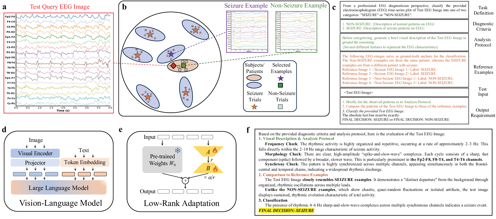
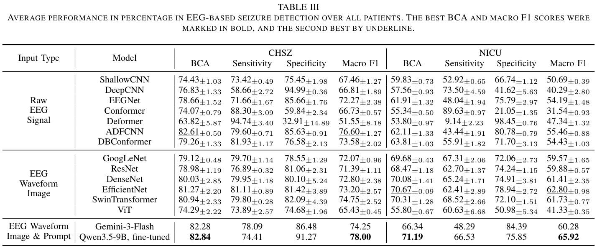
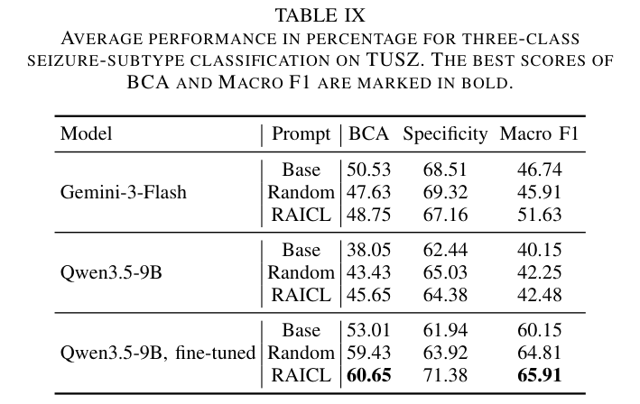

<div align="center">

# VLM4EEG

**Retrieval-Augmented In-Context Learning for Vision-Language-Model Based EEG Seizure Detection**

Brain-Computer Interface and Machine Learning Laboratory &nbsp;·&nbsp; Huazhong University of Science and Technology

Retrieval-augmented in-context learning (RAICL) classifies electroencephalography (EEG) waveform images with a vision-language model (VLM), using expert criteria and retrieved examples without labeled seizures from the test patient.


[](https://arxiv.org/abs/2601.17844)


[**Paper**](https://arxiv.org/abs/2601.17844) &nbsp;·&nbsp; [**Main results**](#main-results) &nbsp;·&nbsp; [**Prompts**](#prompt-variants) &nbsp;·&nbsp; [**Gemini API**](#gemini-api) &nbsp;·&nbsp; [**Fine-tuning**](#fine-tuning-local-vlms) &nbsp;·&nbsp; [**BibTeX**](#citation) &nbsp;·&nbsp; [**HUST-BCIML hub**](https://github.com/sylyoung/HUST-BCIML)

</div>

---

<p align="center"></p>

*RAICL overview: (a) multichannel EEG rendered as a waveform image; (b) representative non-seizure anchors from the test patient and similar seizure examples from auxiliary patients; (c) expert-guided prompt; (d) vision-language model; (e) optional low-rank adaptation (LoRA) fine-tuning; and (f) an untuned model's description and final decision.*

> **RAICL** &nbsp;·&nbsp; *Retrieval-Augmented In-Context Learning for Vision-Language-Model Based EEG Seizure Detection* &nbsp;·&nbsp; [Paper](https://arxiv.org/abs/2601.17844) &nbsp;·&nbsp; [BibTeX](#citation)

## Contents

- [Overview](#overview)
- [Installation](#installation)
- [Data](#data)
- [RAICL](#raicl)
- [Main results](#main-results)
- [Prompt variants](#prompt-variants)
- [Gemini API](#gemini-api)
- [Fine-tuning local VLMs](#fine-tuning-local-vlms)
- [Seizure subtype classification](#seizure-subtype-classification)
- [Repository structure](#repository-structure)
- [Citation](#citation)
- [Acknowledgements](#acknowledgements)
- [Contact](#contact)
- [License](#license)

## Overview

EEG seizure detection usually relies on specialized models trained on labeled signals. Vision-language models offer another route: read the multichannel waveform as an image and supply EEG expertise through text. **RAICL** selects labeled examples for that prompt using two complementary rules. Representative non-seizure trials describe the test patient's background, while seizure examples from other patients are selected for their similarity to the query. The same inputs support inference with an untuned VLM and LoRA fine-tuning of an open-source VLM.

The paper evaluates binary seizure detection on the **[Wuhan Children's Hospital seizure dataset (CHSZ)](https://zenodo.org/records/19333249)** and the **[neonatal intensive care unit (NICU) dataset](https://zenodo.org/records/1280684)** from Helsinki University Hospital, and three-class seizure-subtype classification on the **[Temple University Hospital EEG Seizure Corpus (TUSZ)](https://isip.piconepress.com/projects/tuh_eeg/)**. This repository contains the binary RAICL implementation, the exact prompts for both tasks, Qwen3.5-9B fine-tuning code, and two CHSZ workbooks with complete model responses.

## Installation

```sh
git clone https://github.com/sylyoung/VLM4EEG.git
cd VLM4EEG
python -m pip install -e .
```

Python 3.10+. Retrieval and scoring run on a central processing unit (CPU). Install `".[render,embed]"` and [OpenAI's Contrastive Language-Image Pre-training (CLIP)](https://github.com/openai/CLIP) to prepare EEG images, `".[gemini]"` to query Gemini, or follow [the local VLM setup](docs/finetuning.md#installation) for Qwen. Local Qwen training requires a CUDA-compatible graphics processing unit (GPU) and a compatible LLaMA-Factory installation; Python 3.11 or 3.12 is recommended for that environment.

## Data

Experiments use four-second trials with **18 bipolar EEG channels**. The binary pipeline starts from preprocessed `X.npy` and `y.npy` arrays, with trials in the paper's original patient order.

| Dataset | Task | Patients | Trials before query selection | Sampling rate |
| --- | --- | ---: | ---: | ---: |
| [CHSZ](https://zenodo.org/records/19333249) | Pediatric seizure detection | 27 | 21,227 | 250 Hz |
| [NICU](https://zenodo.org/records/1280684) | Neonatal seizure detection | 39 | 54,073 | 256 Hz |
| [TUSZ](https://isip.piconepress.com/projects/tuh_eeg/) | Non-seizure / focal / generalized | 29 | 80,530 | 250 Hz |

Put binary arrays under `data/CHSZ/` or `data/NICU/`. The CHSZ download contains per-patient MATLAB files at 500 or 1,000 Hz; convert them to the 250 Hz NumPy layout described in [data preparation](docs/data.md), preserving the original patient and trial order. Raw recordings, patient images and trained adapters are not included in this repository; access follows each dataset's terms.

---

## RAICL

**Retrieval-Augmented In-Context Learning for VLM-Based EEG Seizure Detection**

RAICL builds a patient-specific comparison context rather than retrieving every example by similarity alone:

- **Waveform images.** Stack the channels in separate colored lanes, retaining channel names and a shared time axis for the VLM. CLIP uses a base Vision Transformer with 32-pixel patches (ViT-B/32) to encode the corresponding waveform-only images into normalized 512-dimensional vectors for retrieval.
- **Representative background anchors.** Select two non-seizure trials nearest to the centroid of the test patient's earlier non-seizure recordings. These describe the patient's typical background independently of the query.
- **Similar seizure examples.** Retain one representative seizure trial per auxiliary patient, then select the two most similar to the query. Seizure references never come from the test patient.
- **Expert-guided classification.** Give the VLM the four labeled examples, the query image and the EEG criteria. Optional LoRA fine-tuning uses the same context, with only the final decision as the training target.

RAICL needs known non-seizure anchors. When the earlier pool is too small, the implementation supplements it with later non-seizure trials, so the evaluated setting is not strictly causal or fully unlabeled. Waveforms are scaled per channel; generated descriptions are not verified clinical explanations.

### Usage

Prepare the waveform images and retrieval index, then query Gemini:

```sh
python -m pip install -e ".[render,embed,gemini]"
python -m pip install git+https://github.com/openai/CLIP.git

python scripts/render.py --data_dir ./data --dataset CHSZ --workers 4
mkdir -p outputs
python scripts/embed.py --data_dir ./data --dataset CHSZ \
  --image_type Vision --index_from Vision \
  --index_out outputs/index_CHSZ_RawVectors.pkl

# Set your API key first; see Gemini API below.
python scripts/gemini.py --dataset CHSZ --data_dir ./data \
  --index outputs/index_CHSZ_RawVectors.pkl \
  --out outputs/CHSZ_gemini_raicl.csv
```

The installed commands `raicl-render`, `raicl-embed` and `raicl-gemini` run the same scripts. Use `--help` for their arguments. For local Qwen, continue with [fine-tuning](#fine-tuning-local-vlms).

## Main results

<p align="center"></p>

*Binary seizure detection on CHSZ and NICU, averaged over patients. Untuned Gemini with RAICL is competitive with trained signal models; jointly RAICL-fine-tuned Qwen has the highest balanced classification accuracy (BCA) and macro F1 on both datasets. Baselines do not receive the test patient's non-seizure anchors.*

[**Full numerical table (CSV)**](results/seizure_detection.csv) &nbsp;·&nbsp; [**Evaluation and scoring**](results/README.md)

The table reports the current study results; the linked arXiv version is earlier. Signal and image baseline implementations are not included here. The two downloadable workbooks below contain the same **2,783 CHSZ trials from 27 patients**, with labels, selected references and complete responses:

| Model | Adaptation | Responses |
| --- | --- | --- |
| Gemini-3-Flash | Untuned, RAICL at inference | [CHSZ workbook](results/CHSZ_Gemini-3-Flash_RAICL.xlsx) |
| Qwen3.5-9B | Joint LoRA with RAICL examples | [CHSZ workbook](results/CHSZ_Qwen3.5-9B_RAICL-finetuned.xlsx) |

Recompute these two rows without EEG data, model weights or API access:

```sh
python scripts/score.py results/CHSZ_Gemini-3-Flash_RAICL.xlsx \
  results/CHSZ_Qwen3.5-9B_RAICL-finetuned.xlsx
```

Metrics are computed within each patient, then averaged across patients. An answer without a final decision counts as non-seizure; a failed request is not a prediction. These are trial-level results, not event detection or clinical validation.

---

## Prompt variants

The exact templates are in [`prompts/`](prompts/). **Base** asks for a decision, **Reasoning** adds expert EEG criteria, **Random** adds randomly selected examples, and **RAICL** uses representative and similar examples instead.

| Configuration | Binary seizure detection | TUSZ seizure subtype |
| --- | --- | --- |
| **Base** | [Full prompt](prompts/binary/base.txt) | [Full prompt](prompts/tusz/base.txt) |
| **Reasoning** | [Full prompt](prompts/binary/reasoning.txt) | [Full prompt](prompts/tusz/reasoning.txt) |
| **Random** | [Full prompt](prompts/binary/random_examples.txt) | [Full prompt](prompts/tusz/random.txt) |
| **RAICL** | [Full prompt](prompts/binary/raicl.txt) | [Full prompt](prompts/tusz/raicl.txt) |

Binary RAICL uses **two examples per class**, four references plus the query. The three-class prompt uses six references plus the query. Reference images appear before the query: seizure then non-seizure for binary detection; focal, generalized, then non-seizure for TUSZ.

The paper also ablates the **selection rule** while retaining the example-based prompt: random auxiliary-patient examples, random patient-specific background anchors, representative examples, and representativeness plus query similarity.

Two additional binary wording controls are available as [concrete wording](prompts/experimental/concrete_wording.txt) and [decision only](prompts/experimental/decision_only.txt). They were not used for the downloadable workbook results. See [`prompts/README.md`](prompts/README.md) for image slots, exact assembly order and the distinction between prompt wording and reference selection.

## Gemini API

### Get an API key

Connect to the Gemini application programming interface (API) with a key from [**Google AI Studio**](https://aistudio.google.com/apikey), following Google's [API-key instructions](https://ai.google.dev/gemini-api/docs/api-key). Install the Google Gen AI software development kit (SDK) and set the key in the current shell without putting its value in a file or command history:

```sh
python -m pip install -e ".[gemini]"
read -rs GEMINI_API_KEY
export GEMINI_API_KEY
```

Paste the key when `read` waits for input and press Enter; it will not be displayed. Do not commit the key or upload identifiable EEG without the required permissions. Google's API usage, availability and data-handling terms apply.

### Send one EEG image

The minimal example sends the **binary Base prompt** and one waveform image through the Google Gen AI SDK:

```sh
python examples/gemini_api.py \
  --image data/CHSZ/time-chan/VLM/sub_00/class_0/trial_0_VLM.png
```

Use your own existing image path. The [example](examples/gemini_api.py) shows `genai.Client`, inline PNG image parts and `generate_content`; it makes one API request and may incur charges, rather than running a full evaluation. Add `--task tusz` to use the three-class Base prompt instead.

### Run binary RAICL

After [preparing the images and CLIP index](#usage), run:

```sh
python scripts/gemini.py --dataset CHSZ --data_dir ./data \
  --index outputs/index_CHSZ_RawVectors.pkl \
  --prompt prompts/binary/raicl.txt \
  --model gemini-3-flash-preview \
  --out outputs/CHSZ_gemini_raicl.csv
```

The script selects the references for each query and sends text and images in prompt order. It saves complete responses, references and decisions in the CSV, plus a neighboring settings file. `--resume` continues only with matching settings. Request failures stop the run instead of being scored as non-seizure. The recorded model uses temperature 0 and a 2,048-token output budget; changing the model or prompt defines a new condition.

For NICU, use `--dataset NICU` and its own image index. The dataset runner implements **binary RAICL**, not the other prompt configurations or the TUSZ task. See [Gemini setup and outputs](docs/gemini.md) for authentication, a direct Python example and saved-response scoring.

---

## Fine-tuning local VLMs

The supplied training path adapts **Qwen3.5-9B** with LoRA on the visual encoder, projector and language model jointly. Each training query contains RAICL-selected references. Only the final decision is supervised, since expert-written rationales are unavailable.

First install the CUDA, Qwen and LLaMA-Factory dependencies and download the backbone using [the installation commands](docs/finetuning.md#installation). Then prepare, train and evaluate one held-out patient:

```sh
# 1. Build this patient's test list and auxiliary-patient training set.
python scripts/prepare.py --index outputs/index_CHSZ_RawVectors.pkl \
  --subject sub_00 --out-dir outputs/folds/sub_00 \
  --training --model ./models/Qwen3.5-9B

# 2. Train the joint LoRA adapter.
CUDA_VISIBLE_DEVICES=0 python scripts/train.py \
  outputs/folds/sub_00/chsz_raicl_loso_sub_00.yaml

# 3. Evaluate that patient's final adapter with RAICL references.
CUDA_VISIBLE_DEVICES=0 python scripts/qwen.py \
  --model ./models/Qwen3.5-9B \
  --adapter outputs/folds/sub_00/adapter \
  --csv outputs/folds/sub_00/sub_00_raicl.csv \
  --out outputs/CHSZ_qwen_sub_00_raicl.csv \
  --batch-size 4 --max-new-tokens 8192
```

Repeat for all **27 held-out patients**, using each patient's own training set, adapter and query list. The held-out patient contributes neither training queries nor training references. The exact ordered training queries are in [`configs/chsz_loso_training_queries.json`](configs/chsz_loso_training_queries.json).

| Setting | Value |
| --- | --- |
| Fine-tuned modules | Visual encoder + projector + language model |
| LoRA rank / alpha / dropout | 32 / 16 / 0.05 |
| Weight quantization | 4-bit NormalFloat (NF4) with double quantization |
| Learning rate / epochs | `1e-4` / 2 |
| Training batch / gradient accumulation | 1 per device / 16 |
| Training context limit | 4,096 tokens |
| Training target | Final decision only |
| Inference | Greedy decoding, batch 4, up to 8,192 new tokens |
| Adapter used for testing | Final adapter, not selected on test-patient performance |

The [fine-tuning guide](docs/finetuning.md) describes the generated JSONL/YAML files, dependency checks, module ablations and resuming training. The executable fold builder is **CHSZ-specific**; the repository does not include pretrained adapters or a complete TUSZ training pipeline.

## Seizure subtype classification

The TUSZ task distinguishes **NON-SEIZURE**, **FOCAL SEIZURE** and **GENERALIZED SEIZURE**. RAICL retrieves focal and generalized seizure examples separately from auxiliary patients, alongside the test patient's non-seizure anchors. At two examples per class, the VLM receives **seven images** including the query.

The complete [Base](prompts/tusz/base.txt), [Reasoning](prompts/tusz/reasoning.txt), [Random](prompts/tusz/random.txt) and [RAICL](prompts/tusz/raicl.txt) prompts include the three-class decision format. The [shared prompt builder](prompts/tusz/tusz_seizure_type_prompt.py) constructs the same wording with real image paths.

<p align="center"></p>

*Three-class seizure-subtype classification on TUSZ. RAICL improves BCA over random examples for both Qwen configurations, while Gemini's Base prompt remains stronger than its RAICL prompt in BCA.*

[**Numerical table (CSV)**](results/seizure_subtype.csv)

The evaluation uses **1,721 queries from 29 patients**, with two patient groups alternately serving as test and auxiliary groups. BCA averages recall over the ground-truth classes present for each patient, then averages across patients. The table reports study results; TUSZ per-trial responses and training/evaluation runners are not distributed here. Do not run the binary scorer on three-class outputs.

---

## Repository structure

```text
prompts/
  binary/                 # Base, Reasoning, Random and RAICL for seizure detection
  tusz/                   # full three-class prompts and their shared builder
  experimental/           # additional binary wording controls
scripts/
  render.py               # EEG arrays to paired waveform images
  embed.py                # CLIP features and retrieval index
  gemini.py               # binary RAICL through the Gemini API
  prepare.py              # CHSZ held-out-patient lists and training sets
  train.py                # joint Qwen LoRA fine-tuning
  qwen.py                 # evaluate a patient's trained Qwen adapter
  score.py                # recompute the two CHSZ workbook results
src/raicl/                # retrieval, prompt assembly, metrics and Qwen helpers
configs/                  # exact CHSZ training-query manifest
results/                  # full comparison tables and two CHSZ response workbooks
examples/gemini_api.py    # one-image Gemini API example
figures/                  # method and result-table images
docs/                     # data preparation, Gemini setup and local fine-tuning
```

All commands run from the repository root after installation. Keep local data in `data/`, model weights in `models/` and new outputs in `outputs/`; these are excluded from version control.

## Citation

If you find this repository helpful, please cite our work:

```bibtex
@article{Li2026RAICL,
  author  = {Li, Siyang and Wang, Zhuoya and Gui, Xiyan and Chen, Xiaoqing and Wang, Ziwei and Wen, Yaozhi and Wu, Dongrui},
  title   = {RAICL: Retrieval-Augmented In-Context Learning for Vision-Language-Model Based EEG Seizure Detection},
  journal = {arXiv preprint arXiv:2601.17844},
  year    = {2026},
  url     = {https://arxiv.org/abs/2601.17844}
}
```

## Acknowledgements

Retrieval uses [OpenAI CLIP](https://github.com/openai/CLIP). Qwen loading, multimodal templates and LoRA training use [LLaMA-Factory](https://github.com/hiyouga/LLaMA-Factory), [Transformers](https://github.com/huggingface/transformers), [Parameter-Efficient Fine-Tuning (PEFT)](https://github.com/huggingface/peft) and bitsandbytes. The [Qwen batch-input helper](src/raicl/models/qwen_batch_inputs.py) adapts LLaMA-Factory's Hugging Face engine. Gemini access uses the [Google Gen AI SDK](https://github.com/googleapis/python-genai). We thank their authors.

## Contact

For questions about the paper/research, contact syoungli@hust.edu.cn or lsyyoungll@gmail.com. For questions about the code, please open an [Issue](https://github.com/sylyoung/VLM4EEG/issues).

## License

Original code is released under the [MIT License](LICENSE). The adapted Qwen batch-input helper retains its [Apache-2.0 license](licenses/LLaMA-Factory.txt). Model and dataset licenses apply independently.

---

<div align="center"><sub>

Part of the <a href="https://github.com/sylyoung/HUST-BCIML">HUST-BCIML</a> open-source code home &nbsp;·&nbsp; Brain-Computer Interface and Machine Learning Laboratory, HUST

</sub></div>
